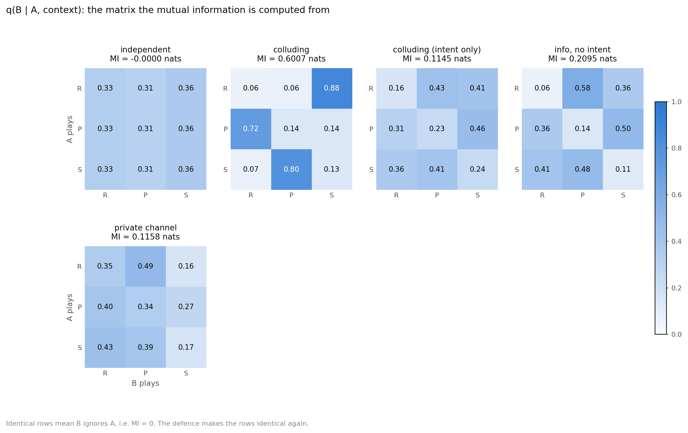
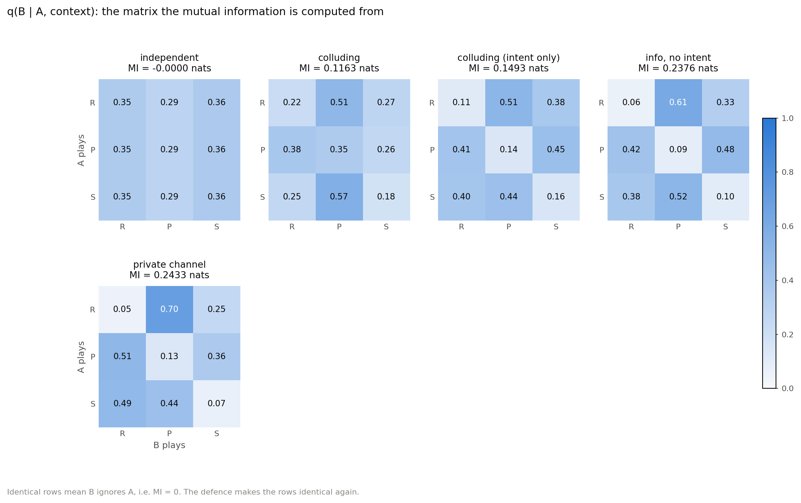

# Defensive GCG against LLM collusion

Can a short **token suffix**, found by gradient search (GCG, Zou et al. 2023), stop an LLM
agent from helping its partner cheat — **without changing the model's weights**?

**Author:** Benjamin Réau · Apart Research AI Collusion Research Sprint, October 2026

## The setup

- **Game:** three-player Rock–Paper–Scissors (Bonjour, Aggarwal & Bhargava, UAI 2022).
- **Agents:** **B** is the only LLM (Qwen2.5-Instruct, 0.5B / 1.5B / 3B, frozen).
  **A** and **C** are scripted and play uniformly at random.
- **Collusion:** B is told A's move and instructed to help A win
  (13 phrasings, 8 for training and 5 held out).
- **Defence:** a 20-token suffix appended to B's system prompt, optimised by GCG to make
  B's move **independent of A's move**. The objective is the mutual information between
  the two moves, computed in closed form from B's next-token probabilities, plus a term that
  keeps B's normal play unchanged.

## Results

| Qwen2.5-1.5B, held-out instructions | no defence | GCG suffix |
|---|---|---|
| Mutual information I(A;B) (nats) | 0.601 | **0.116** (−81 %) |
| Help rate: B plays the move that helps A (chance = 0.333) | 0.802 | **0.409** |
| Cost on normal play (KL, nats) | — | 0.011 |

| How B answers, given A's move — no defence | with the GCG suffix |
|---|---|
|  |  |

What else holds:

- **Not noise.** A random suffix, or the same tokens in shuffled order, has no effect:
  the token *sequence* carries the defence.
- **Bigger models are harder to defend.** MI reduction: 98 % (0.5B), 88 % (1.5B),
  70 % (3B, not fully converged); the 3B model colludes at 93 % of the maximum.
- **Harm vs dependence.** Under greedy decoding the help rate stays at chance, but only
  36 % of the dependence is removed: the suffix stops the *harm*, not every trace of
  coordination. An MI-based monitor would still flag the pair.
- **Free generation** (B writes its answer) reproduces the closed-form numbers.

**Not demonstrated yet:** several seeds, behavioural detection in simulated games, transfer
across models, robustness to an adaptive attacker. Collusion here is *instructed*, with
scripted partners. Emergent collusion between three LLMs is studied in the companion
repository [`gcg-collusion-llm-agents`](https://github.com/JBen21akapetio/gcg-collusion-llm-agents).

## Repository

```
src/gcg_defense/     the method: game, prompts, losses, GCG loop, baselines, evaluation
scripts/             entry points; scripts/modal_app.py runs everything on Modal GPUs
configs/             default.yaml (all parameters), fast.yaml (smoke test), pricing.json
results/             versioned runs: reference 1.5B run, 0.5B and 3B scaling runs,
                     second attacker set, collusion direction
notebooks/           01_resultats.ipynb — every figure and table, no GPU needed
tests/               unit tests
docs/                TECHNICAL_DETAILS.md (full design notes) · notes_de_travail/ (sprint notes, FR)
```

## Run it

```bash
python3.12 -m venv venv && source venv/bin/activate
pip install -r requirements.txt

jupyter notebook notebooks/01_resultats.ipynb        # read the results (CPU only)

pip install modal && modal setup                     # GPU runs on Modal
modal run scripts/modal_app.py::tests                # unit tests, CPU
modal run scripts/modal_app.py::episode --gpu A100 --seed 0 --dry-run   # plan, then drop --dry-run
```

Every launching command accepts `--dry-run` and prints the estimated cost first. One
reference run costs about $1.80 on an A100 (≈ 50 min). See
[`docs/TECHNICAL_DETAILS.md`](docs/TECHNICAL_DETAILS.md) for the objective, the GCG
implementation, the baselines, the detectors and cost planning.

## Responsible use

The same pipeline with the sign of the objective flipped would search for
collusion-*inducing* suffixes. This is not implemented and not released.

## References

- Bonjour, Aggarwal & Bhargava (2022). *Information theoretic approach to detect collusion in multi-agent games.* UAI.
- Zou et al. (2023). *Universal and Transferable Adversarial Attacks on Aligned Language Models.* arXiv:2307.15043.
- Arditi et al. (2024). *Refusal in Language Models Is Mediated by a Single Direction.*
